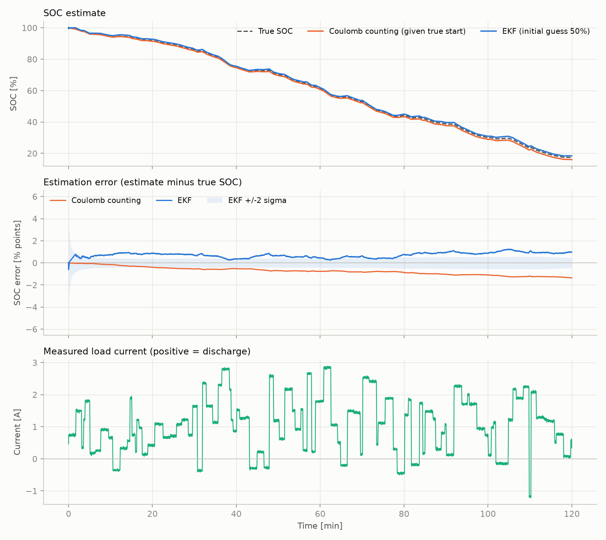
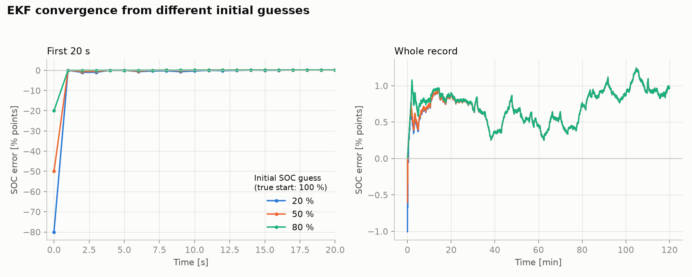
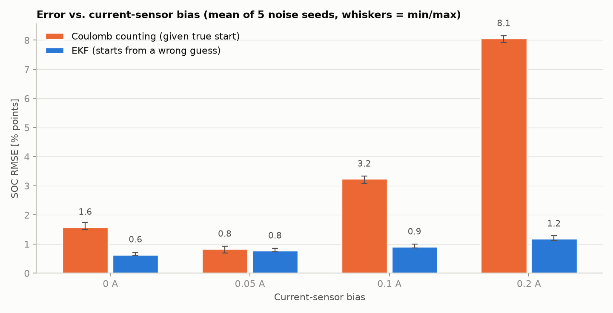

# Battery SOC Estimation with an Extended Kalman Filter

Python implementation of state-of-charge (SOC) estimation for a lithium-ion cell. A first-order Thevenin equivalent-circuit model is combined with an Extended Kalman Filter (EKF) that fuses current integration with the measured terminal voltage. It is compared against plain coulomb counting on simulated data with realistic imperfections.

## Method

**Cell model (1 RC pair).** States are SOC and the RC-pair voltage V1:

```
SOC[k+1] = SOC[k] - eta * I[k] * dt / (3600 * Q)
V1[k+1]  = a * V1[k] + R1 * (1 - a) * I[k],      a = exp(-dt / (R1*C1))
Vt[k]    = OCV(SOC[k]) - V1[k] - R0 * I[k]
```

**EKF.** The prediction step uses the linear model above. The measurement update linearises the nonlinear OCV curve with H = [dOCV/dSOC, -1] and uses the Joseph form for the covariance update.

**Test data (simulated).** A random 2 h discharge profile (about 0.5C average, with short regen pulses) on a 2.5 Ah NMC-like cell. The simulated "true" cell deliberately differs from what the filter knows:

| Imperfection | Value |
|---|---|
| Capacity | true 2.42 Ah, filter assumes 2.5 Ah (3 %) |
| R0 / R1 / C1 | true 50 mOhm / 22 mOhm / 1900 F, filter 45 / 20 / 2000 |
| OCV curve | true curve shifted by +10 mV, unknown to the filter |
| Current sensor | bias (default 0.05 A) + 20 mA noise |
| Voltage sensor | 5 mV noise |
| Initial SOC | filter starts at 50 %, true value is 100 % |

## Results

Default run (`python main.py`), errors after the first 10 minutes:

| | RMSE [% points] | Max abs. error |
|---|---|---|
| EKF (starts from a 50 % guess) | 0.76 | 1.25 |
| Coulomb counting (given the *true* start) | 0.85 | 1.36 |

At the default 0.05 A current bias the two are comparable. This is partly luck: the bias and the 3 % capacity error push coulomb counting in opposite directions. The EKF's advantage shows up in two other places:

1. **Wrong initial SOC.** Coulomb counting can never recover from a wrong start. The EKF is within about 1 % of the truth after a few seconds, even from a 20 % guess (`results/convergence.png`).
2. **Current-sensor bias** (mean of 5 noise seeds, RMSE in % points):

| Bias [A] | Coulomb counting | EKF |
|---|---|---|
| 0.00 | 1.59 | 0.64 |
| 0.05 | 0.83 | 0.77 |
| 0.10 | 3.24 | 0.91 |
| 0.20 | 8.06 | 1.18 |

Coulomb-counting error grows with the bias and with time; the EKF stays bounded because the voltage measurement keeps correcting it.





## Run it

```bash
pip install -r requirements.txt
python main.py                      # synthetic data, writes plots to results/
python main.py --soc-guess 0.3      # worse initial guess
python main.py --current-bias 0.1   # stronger sensor bias
python main.py --csv my_data.csv    # your own data
```

CSV format: header `time_s,current_a,voltage_v` and optionally `soc_true`; current is positive for discharge. Without `soc_true` the plots are produced but error metrics are skipped. For real data, replace the OCV curve in `soc_ekf/battery.py` and the cell parameters in `CellParams` with values identified for your cell. The defaults are generic.

## Project structure

```
soc_ekf/battery.py       Thevenin cell model, OCV curve
soc_ekf/ekf.py           EKF and coulomb-counting baseline
soc_ekf/data.py          synthetic data generator, CSV loader
soc_ekf/experiments.py   current-bias robustness sweep
soc_ekf/plots.py         figures
main.py                  command line entry point
```

## Limitations

- **All results are on simulated data**, not a real cell. The simulated cell uses the same model structure as the filter (only its parameters differ), so real cells will be harder: temperature dependence, OCV hysteresis, ageing and parameter drift are not modelled.
- The OCV curve and cell parameters are generic, illustrative values, not identified from measurements.
- The filter is overconfident: its +/-2 sigma band does not cover the roughly 1 % error caused by the unmodelled 10 mV OCV offset. Process and measurement noise were set by hand, not tuned systematically.
- Single cell, 1 s sampling, no parameter or capacity estimation.

## Ideas for extension

- Run it on a public dataset (e.g. NASA or CALCE cell data) after identifying the OCV curve and R0/R1/C1
- Estimate R0 or capacity online (dual or joint EKF), or try an Unscented Kalman Filter
- Add temperature dependence and OCV hysteresis
